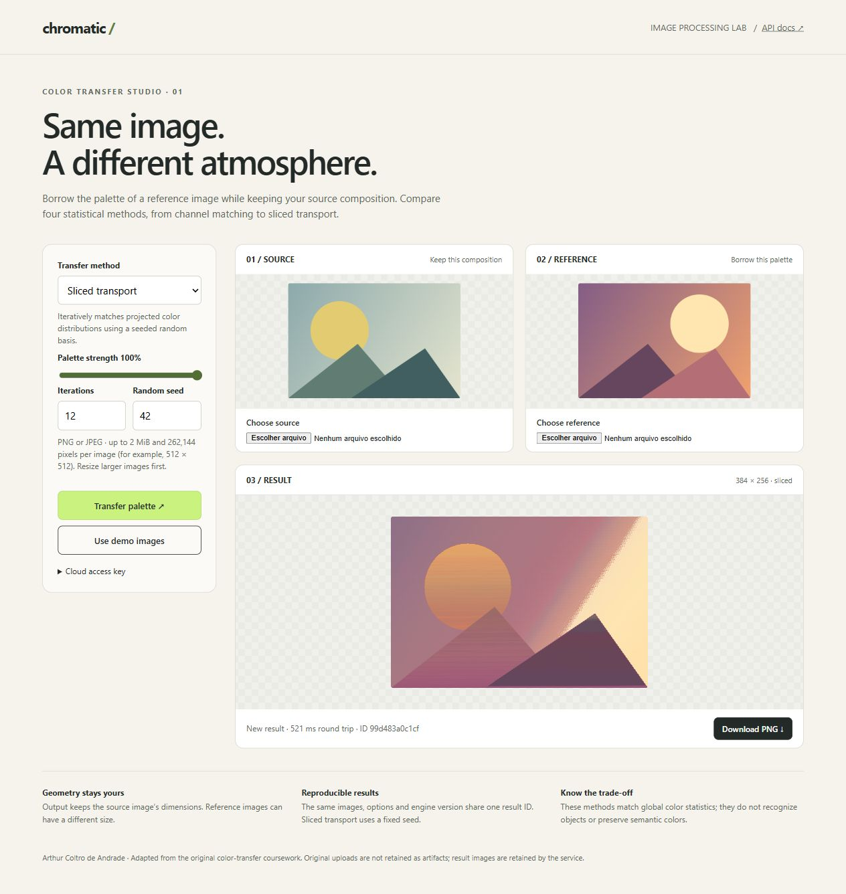

# Chromatic — Color Transfer Studio

A software-engineering extension of Arthur Coltro de Andrade's image-processing coursework: upload a source image and a palette reference, compare four numerical methods, and download the result. Includes a FastAPI backend, a browser studio, pytest tests, a non-root Docker image and AWS SAM infrastructure.



## Run locally

Python 3.12+ (tested on Python 3.13). From this directory:

```powershell
python -m venv .venv
.venv/Scripts/python.exe -m pip install -r requirements-dev.txt
.venv/Scripts/python.exe -m uvicorn chromatic.api:app --host 127.0.0.1 --port 8000
```

Open **http://127.0.0.1:8000**, click **Use demo images**, then **Transfer palette**. Interactive API documentation is at `/docs`. Demo images are generated in your browser; no sample photographs or external assets are downloaded.

On macOS/Linux use `.venv/bin/python` instead. 

```sh
docker compose up --build
```

The Docker service binds to localhost, runs as UID 10001, and keeps results in a named volume. Docker Compose can stop the service with `docker compose down`; the named volume persists. `COLOR_API_KEY` enables shared-key access locally as well as on AWS.

## API

```sh
curl -X POST http://localhost:8000/api/v1/transfers \
  -F source=@source.jpg -F reference=@palette.png \
  -F method=covariance -F strength=0.85
```

Use `curl.exe` on Windows. The response contains `id`, `result_url`, image dimensions, engine version, options, original processing time and `cached`. The first request returns **201**, and an existing artifact returns **200**. Fetch `result_url` for the PNG; `GET /api/v1/transfers/{id}` returns metadata. Add `-H 'X-API-Key: ...'` when access control is enabled.

| Method | Operation | Main limitation |
|---|---|---|
| `rgb` | Per-channel mean/standard-deviation matching | Ignores correlations between channels |
| `lalphabeta` | Moment matching in decorrelated logarithmic LMS lαβ space | Not CIE L*a*b*; nonlinear round-trip can alter brightness |
| `covariance` | RGB whitening and recoloring with regularized covariance matrices | A global linear mapping; clipping changes target statistics |
| `sliced` | Seeded random orthogonal projections and 1-D quantile matching | Slower; finite iterations approximate distribution alignment |

Source always supplies spatial structure; reference supplies color statistics. Reference dimensions may differ. Output dimensions match source. `strength` blends the original and transformed RGB; `seed` and `iterations` control sliced transfer. A constant source channel maps to the reference mean rather than dividing by zero. Covariance is regularized for singular inputs.

Limits: PNG/JPEG only, **2 MiB and 262,144 pixels per image**, **30 iterations maximum**. Inputs are never silently resized. Alpha composites on white; EXIF orientation is applied; profiles are not color-managed. PNG results omit original EXIF. These are global statistical algorithms, without segmentation, medical validation or semantic color preservation.

## Engineering decisions

```text
browser / API client
    → actual-byte body limit → upload & parameter validation
    → oriented RGB → SHA-256(images + options + engine version)
    → artifact cache
         miss → numerical engine → PNG + JSON bundle → commit
    → metadata + authenticated PNG retrieval

storage boundary: local atomic files | private S3 objects
deployment: Docker + Uvicorn | API Gateway HTTP API → Lambda + Mangum → S3
```

- **Reproducibility:** no global RNG; fixed seed for sliced transfer. The hash includes decoded RGB, dimensions, every option and an explicit algorithm version. Bump `ENGINE_VERSION` when numerical semantics change. Determinism is scoped to the tested dependency/platform environment; BLAS or library changes can affect floating-point rounding.
- **Atomic publication:** PNG and JSON are bundled into one ZIP object. Local writes fsync a temporary file before an atomic hard-link commit (NTFS/ext4; same filesystem). Readers see a whole result. Temporary files are removed on handled failures; an abrupt process termination can leave `.pending-*` files, which readers ignore. This is process-crash consistency, not a universal power-loss guarantee.
- **Concurrency:** simultaneous cache misses can duplicate computation. This prototype does not promise exactly-once processing or distributed locking. Each successful publication contains a complete artifact. S3 persists whole objects and never relies on Lambda's temporary filesystem.
- **Bounded work:** actual request bytes are limited before multipart parsing, including chunked requests. Pixel count is checked before image decompression. Numerical work runs in FastAPI's synchronous worker pool, outside the event-loop thread.
- **Storage:** originals are not persisted as artifacts. The multipart framework may spool temporary uploads to disk; decoded arrays and results occupy memory during processing. Only result PNGs and minimal metadata are retained. Local results have no automatic expiration. AWS expires result objects after seven days; S3 lifecycle deletion is asynchronous.
- **Access:** cloud mode requires a shared key checked with constant-time comparison on create/read endpoints. The studio never persists it in browser storage. This is a single-owner portfolio demo, without per-user isolation, accounts or production-grade abuse prevention. A holder of the key can access known result IDs. Public `/`, `/docs` and `/healthz` do not reveal stored images.
- **Observability:** structured transfer logs include result ID, method, cache hit and latency, without uploaded images, filenames or API keys. Uvicorn access logs are separate. `processing_ms` is the first computation's time; the UI's round-trip latency includes transfer and retrieval.

## Verify

```sh
python -m pytest --cov=chromatic --cov-report=term-missing --cov-fail-under=85
python -m ruff check .
python scripts/benchmark.py --size 256 --repeats 5
```

Tests cover algorithm invariants and statistics, singular images, reproducibility, validation, authentication, byte/pixel limits, cache reuse after app recreation, concurrent durable-file publication, AWS SDK contracts with `botocore.stub.Stubber`, and binary Lambda responses. No tests require AWS credentials or transmit images to AWS.

GitHub Actions runs lint, tests, a repeatable benchmark, a Docker build and container health check, and SAM template validation.

Top-level dependencies are pinned. `requirements-lock.txt` records the complete tested Python environment; dev tools are in `requirements-dev.txt`. CI/container builds use the complete lock to keep transitive versions consistent. See [verification](docs/VERIFICATION.md) for results and remaining unverified components.

## AWS

See [AWS deployment guide](docs/AWS.md). `template.yaml` defines API Gateway HTTP API, Lambda, a private encrypted S3 bucket, least-privilege object permissions, throttling and log retention. **Infrastructure is prepared, not deployed.** No AWS account was accessed and no billable resources were created.

## Project

Created by Arthur Coltro de Andrade as an extension of his image-processing coursework. The original color-transfer notebook is unchanged; this service adds API boundaries, persistence, testing, packaging and a browser interface.

Read [the walkthrough](docs/WALKTHROUGH.md) for the algorithms, architecture and extension ideas.

> Extended a color-transfer notebook into a tested FastAPI service with four algorithms, a browser interface, content-addressed artifact caching, Docker packaging and AWS Lambda/S3 deployment configuration.

AWS deployment configuration is included; actual cloud deployment has not been performed.
